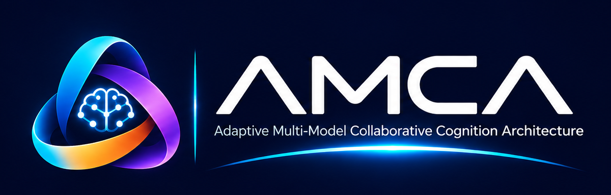
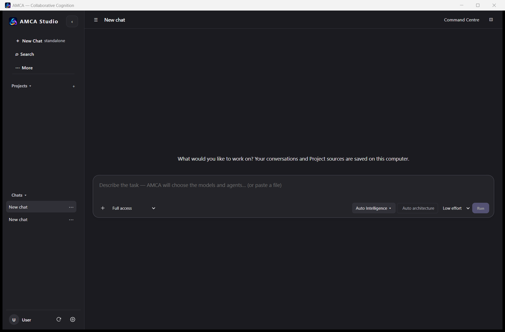
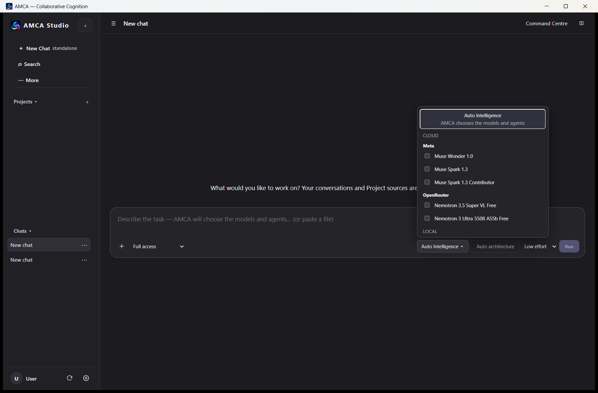
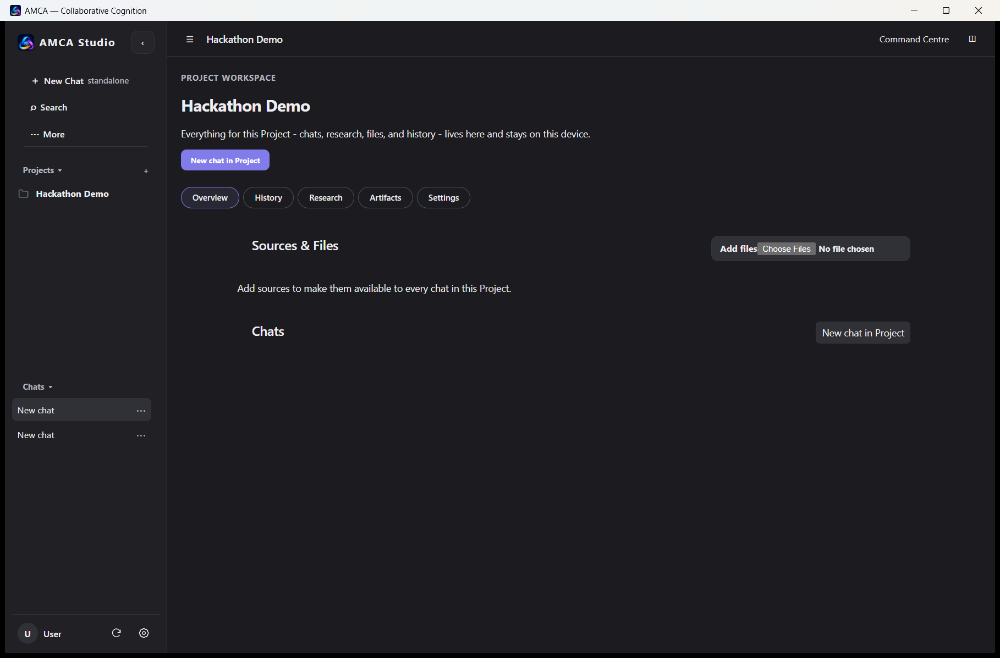
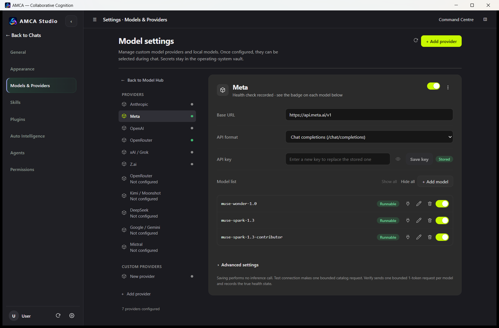

<p align="center">
  
</p>

<h1 align="center">AMCA Studio</h1>

<p align="center">
  <strong>Beyond Single-Model AI</strong> &nbsp;·&nbsp; Multiple Models. Shared Intelligence. One Goal.
</p>

<p align="center">
  
  
  
  
  <a href="https://github.com/ashraful388/amca-studio/releases/latest"></a>
</p>

**AMCA Studio** is a local-first desktop platform for **Adaptive Multi-Model Collaborative Cognition**: instead of one assistant answering alone, heterogeneous AI models — cloud (Meta, OpenRouter, Anthropic, OpenAI, xAI, Z.ai, Google, Mistral, DeepSeek, Kimi…) and local — are organized into a small, governed team that shares structured working state, challenges claims, requests evidence, and adapts its collaboration style as a task evolves.

Built as a **Tauri 2 + React** desktop client over a **loopback Python** service. Your projects, chats, sources, and decision history live on your machine; model credentials stay in the operating-system vault.

---

## 📥 Download AMCA Studio

> **[⬇️ Download the latest installer](https://github.com/ashraful388/amca-studio/releases/latest)** — always points to the newest release.

**Direct download — v1.1.21:**

- 📦 **[amca-studio-v1.1.21-windows-x64-setup.exe](https://github.com/ashraful388/amca-studio/releases/download/v1.1.21/amca-studio-v1.1.21-windows-x64-setup.exe)** (~40 MB)
- 🔐 Integrity: SHA-256 `85c2dc8b9b89c2d06f3a04f1ca445f6f5df4828d14c6f95bd60eebd66c7af30a` — see [amca-studio-v1.1.21-SHA256SUMS.txt](https://github.com/ashraful388/amca-studio/releases/download/v1.1.21/amca-studio-v1.1.21-SHA256SUMS.txt), verify with `Get-FileHash .\amca-studio-v1.1.21-windows-x64-setup.exe -Algorithm SHA256`
- 📚 All releases: [github.com/ashraful388/amca-studio/releases](https://github.com/ashraful388/amca-studio/releases)

**What you need:**

- Windows 10/11 x64 (WebView2 runtime is auto-provisioned by the installer)
- Your own model API keys (Meta, OpenRouter, Anthropic, OpenAI, xAI, Z.ai, …) — stored in the OS credential vault, never bundled
- The app creates its own local data directory on first run — no accounts, no sign-up, nothing pre-installed

---

## Highlights

- **Model Hub (BYOK)** — provider-neutral connections with per-provider base URL, API format, key storage in the OS vault, per-model health checks and enablement. Ships with presets for Meta (`api.meta.ai/v1`), OpenRouter, Anthropic, OpenAI, xAI/Grok, Z.ai and more; add any OpenAI-compatible endpoint as a custom provider.
- **Auto Intelligence** — AMCA chooses the models and agents for a task; capability gates (deterministic planner, adaptive planning, hybrid execution, nano agents) are *governed*: readiness is reported truthfully and nothing enables itself silently.
- **Dynamic Agent Fabric** — for every task the runtime builds the smallest effective temporary AI organization; a live monitor shows created/queued/running/completed/failed/cancelled nano workers, grouped by task, with an execution tree where authority only shrinks parent → child and cancellations cascade.
- **Project workspaces** — a Project holds its own chats, shared sources, instructions, and execution history ("Everything for this Project … lives here and stays on this device"), with a collaboration overview recording purpose, workflows executed, artifacts generated, and participating models/agents.
- **Permission-aware execution** — three global policies (Ask before changes / Autonomous / Full access), exact-scope cloud-transmission approval cards, revocable folder grants, and a Command Centre exposing pending approvals, runs, automations, activity/provenance, and tools.
- **Single-voice answers** — multi-model work is reconciled into one AMCA answer with a transparent thinking feed, instead of a wall of attributed chat slices.
- **Effort control** — Low / High / Max reasoning effort per run.

## Screenshots

| | |
|---|---|
|  |  |
| *Composer — describe the task, AMCA organizes the team* | *Model picker — Meta Muse, OpenRouter, local models* |
|  |  |
| *Project workspace — durable and local* | *Model Hub — Meta provider with health-checked Muse models* |

## How it works

```
┌──────────────────────────────────────────────────────────┐
│  Tauri 2 / React desktop client (AMCA Studio UI)         │
└───────────────────────────┬──────────────────────────────┘
                            │ loopback HTTP (127.0.0.1)
┌───────────────────────────▼──────────────────────────────┐
│  Python orchestration kernel (src/amca)                  │
│  • versioned shared state, typed events, SQLite recovery │
│  • collaboration structures: Solo / Joint / Independent- │
│    then-Discuss / Parallel Decomposition / Adaptive      │
│  • checkpoints with dispositions, deadlines, evidence    │
│    gates and critical-dissent blocking                   │
│  • cost/latency/token accounting, hash-chained audit log │
└───────────┬──────────────────────────────────────────────┘
            │ provider-neutral adapters (BYOK, key in OS vault)
┌───────────▼──────────────────────────────────────────────┐
│  Meta · OpenRouter · Anthropic · OpenAI · xAI · Z.ai ·   │
│  Google · Mistral · DeepSeek · Kimi · custom endpoints · │
│  local runtimes                                          │
└──────────────────────────────────────────────────────────┘
```

Collaboration is a **structure, not a vibe**: joint deliberation, sealed independent exploration followed by discussion, parallel decomposition, and deterministic adaptive hybrid modes are formal contracts with recorded participant dispositions — so disagreements are settled by evidence and checkpoints, not by majority vote.

## Security & privacy posture

- **Local-first**: conversations, project sources, and decision history are stored on the device; the desktop service binds to loopback only.
- **Credentials in the OS vault**: API keys are never written into project files or chat content.
- **Exact-scope approvals**: sensitive actions and cloud transmissions can require per-call approve/deny cards; single-use and scope checks stay enforced.
- **Redaction by default**: secrets and key-like strings are scrubbed from logs and surfaced records (see the redaction test suite under `tests/`).

## Repository layout

```
src/            Python orchestration kernel (amca package)
desktop-ui/     Tauri 2 + React + TypeScript client (src-tauri shell)
packaging/      build scripts (backend PyInstaller spec, NSIS installer)
tests/          Python test suite (pytest)
docs/           architecture, specification, providers, guides
licenses/       third-party license notices
config/         configuration assets
benchmarks/ · experiments/   research records
```

## Development setup

Requirements: **Python 3.11+**, **Node.js 18+**, **Rust** (for the Tauri shell), Windows x64 for installer builds.

```bash
# 1. Backend (editable install)
pip install -e .

# 2. Frontend dependencies
cd desktop-ui && npm install

# 3. Run the desktop app in development (starts Vite + Tauri + backend)
npm run dev:tauri

# 4. Frontend model tests
npm run test:frontend

# 5. Python tests (from the repository root)
python -m pytest tests -q
```

Build the Windows installer (backend + frontend + NSIS bundle):

```powershell
powershell -ExecutionPolicy Bypass -File packaging/build_desktop.ps1 -Bundle nsis
```

The installer is also published under [Releases](../../releases) as `amca-studio-v1.1.21-windows-x64-setup.exe`.

## Version 1.1.21

- single-voice AMCA answers with a transparent thinking feed,
- credential blur-commit fix (a pasted API key can no longer sit unstored),
- official AMCA branding and iconography, interface cleanup.

See [`docs/AMCA-Studio-v0.6.0-Alpha-Release-Notes.md`](docs/AMCA-Studio-v0.6.0-Alpha-Release-Notes.md) and the documents under [`docs/architecture/`](docs/architecture) for the full design record.

## License

Released under the [MIT License](LICENSE). Third-party components are covered by the notices in [`licenses/`](licenses).

## 👤 Developer

<p align="center">
  <strong>Dr. Md. Ashraful Babu</strong><br/>
  Associate Professor<br/>
  Department of Physical Sciences<br/>
  <a href="https://www.iub.edu.bd">Independent University, Bangladesh</a><br/>
  Dhaka, Bangladesh
</p>

---

<p align="center">
  <sub>AMCA Studio — Adaptive Multi-Model Collaborative Cognition Architecture. Submitted to the Meta Global AI Developer Hackathon · “Push the Frontier”.</sub>
</p>
