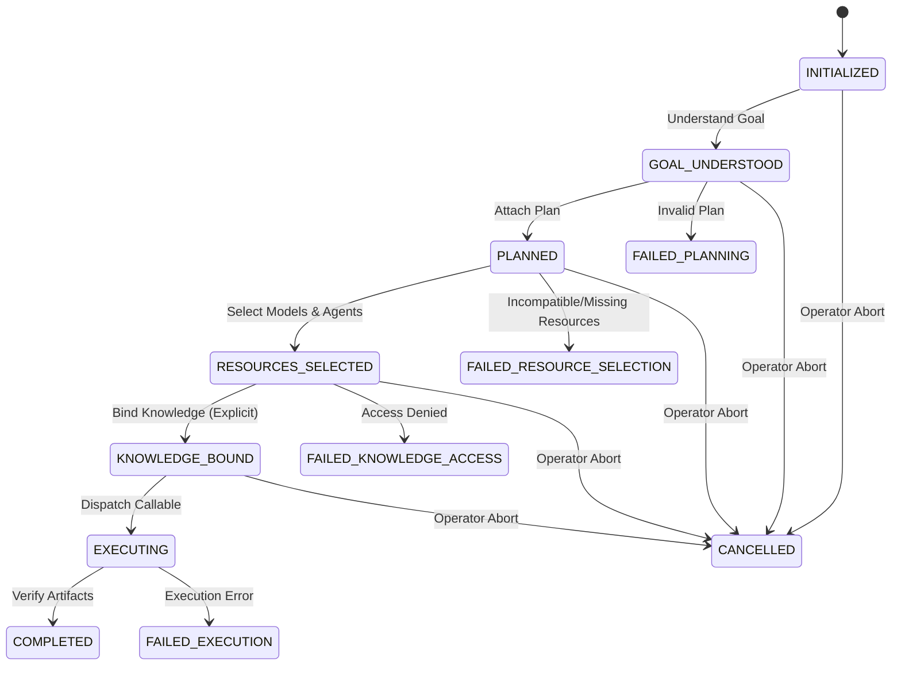

# AMCA Studio: v0.8.0 Cognitive Workflow Loop Foundation Report

**Milestone**: `AG-AMCA-STUDIO-V0.8.0-COGNITIVE-WORKFLOW-LOOP-FOUNDATION-01`  
**Product**: AMCA Studio (v0.8.0 Architecture & Cognition Track)  
**Status**: **COGNITIVE WORKFLOW LOOP FOUNDATION IMPLEMENTED & VERIFIED (PASS)**  
**Target Version**: `v0.8.0-dev`  
**Date**: September 2, 2026  

---

## 1. Executive Summary

This milestone delivers the architectural foundation for the complete, governed AMCA Cognitive Workflow Loop:
$$\text{Goal} \longrightarrow \text{Understand} \longrightarrow \text{Plan} \longrightarrow \text{Select Resources} \longrightarrow \text{Retrieve Knowledge} \longrightarrow \text{Execute} \longrightarrow \text{Verify} \longrightarrow \text{Learn}$$

### Key Architectural Tenets:
1. **Coordination Without Replacement**:
   - `CognitiveWorkflowOrchestrator` (`software/src/amca/cognitive_loop_orchestrator.py`) purely coordinates existing subsystems (Model Router, Agent Fabric, Knowledge Service, Workflow Engine) without duplicating or overriding their decision algorithms.
2. **Deterministic & Observable State Machine**:
   - Explicit lifecycle states: `INITIALIZED`, `GOAL_UNDERSTOOD`, `PLANNED`, `RESOURCES_SELECTED`, `KNOWLEDGE_BOUND`, `EXECUTING`, `COMPLETED`.
   - Clean, unambiguous failure states: `FAILED_PLANNING`, `FAILED_RESOURCE_SELECTION`, `FAILED_KNOWLEDGE_ACCESS`, `FAILED_EXECUTION`, `CANCELLED`.
3. **Structured Non-Invasive Contracts**:
   - `GoalUnderstandingRecord`: Captures structured intent, domain, constraints, and required outputs. **Zero hidden reasoning, zero chain-of-thought storage.**
   - `CognitivePlanRecord`: Captures planned steps, required capabilities, strategy, and dependencies.
   - `ModelAgentSelectionTrace`: Tracks model and agent selections alongside provider health evidence.
   - `KnowledgeBindingTrace`: Records explicit knowledge query intent, retrieved artifact references, permission outcome, and audit ledger IDs.
   - `VerificationRecord`: Validates artifact production and execution success with zero subjective AI scores.
   - `LearningSignalRecord`: Captures structured runtime telemetry (duration, retries, failures, resource metrics) for future optimization without automated self-mutation.
4. **Local SQLite Persistence & Recovery**:
   - `CognitiveWorkflowStore` enforces strict workspace partitioning (`workspace_id`), supports restart recovery, and maintains audit traceability.

---

## 2. Cognitive Loop Lifecycle State Machine

---

## 3. Test & Verification Summary

| Test Area | Invariant Tested | Result |
| :--- | :--- | :--- |
| **Full Lifecycle** | Complete end-to-end traversal from Goal to Completed | **PASS** |
| **Decoupling Integrity** | Model Router and Agent Fabric free from orchestration imports | **PASS** |
| **Anti-Injection** | Knowledge requires explicit binding; zero auto-injection | **PASS** |
| **Zero Hidden Reasoning**| Dictionary representations contain no chain-of-thought | **PASS** |
| **Failure State Routing** | Correct state transitions on missing models, denied access, cancellation | **PASS** |
| **Persistence & Isolation**| SQLite store guarantees workspace separation and restart recovery | **PASS** |
| **v0.8.0 Suite Total** | 61/61 tests pass across all v0.8.0 tracks | **PASS** |
| **Studio Regression** | Full studio regression suite passes across all 219 tests | **PASS** |

